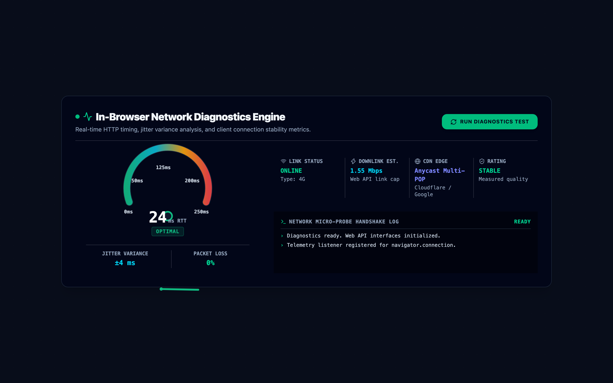
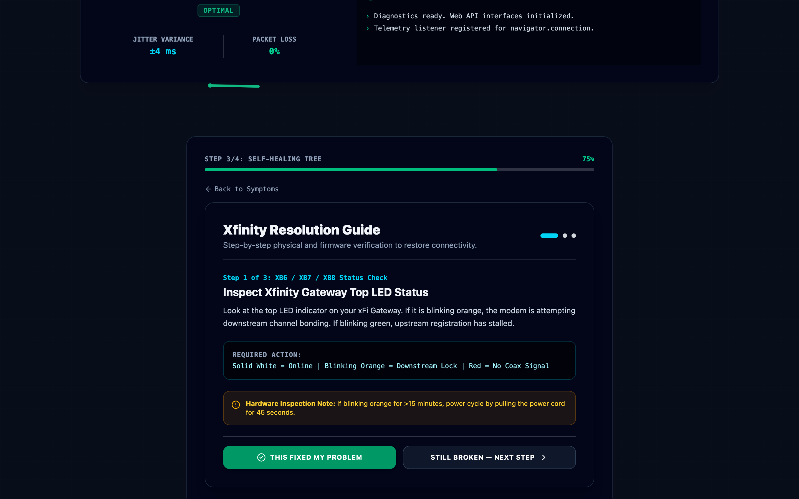
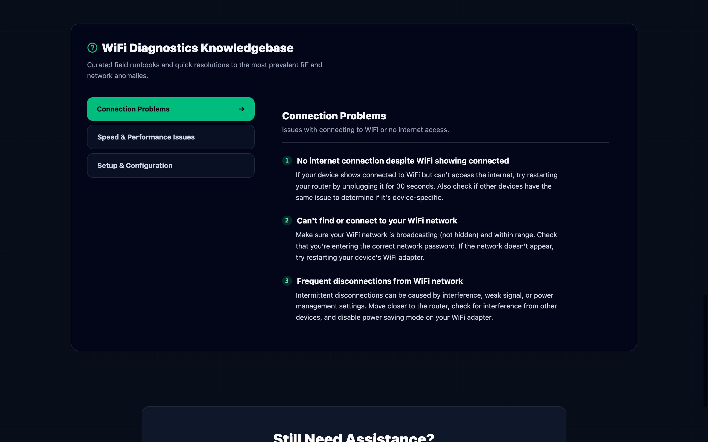
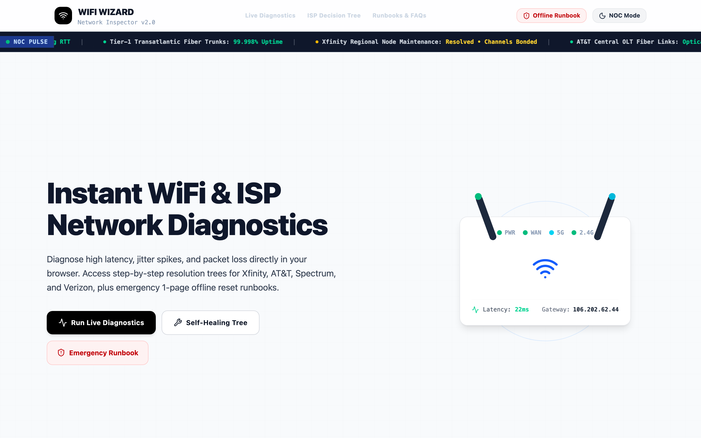

# WiFi Diagnostic Wizard & NOC Operations Center ⚡

[](https://kanishk-upadhyay.github.io/wifi/)
[](https://react.dev/)
[](https://tailwindcss.com/)
[](https://www.framer.com/motion/)
[](LICENSE)

A high-performance in-browser client network diagnostics engine, ISP self-healing decision tree, and emergency offline recovery manual. Built with **React 19**, **Web APIs** (Performance, Fetch, Network Information), and **Framer Motion**, featuring both **Modern Expressive Light** and **NOC (Network Operations Center) Dark Mode**.

---

## 📸 Visual Showcase

### NOC Live Diagnostics Engine & Real-Time Speedometer
> Real HTTP micro-burst timing against multi-region CDN endpoints, radial SVG speedometer gauge, jitter stability, packet loss analysis, and monospace diagnostic terminal logs.



---

### ISP Self-Healing Decision Tree
> Interactive, provider-specific diagnostic branches (Xfinity, AT&T, Spectrum, Verizon, T-Mobile) with hardware LED status inspection, coaxial/ONT checks, and self-service resolution before escalation.



---

### Emergency Offline Protocol & Recovery Runbook
> One-click field manual with 60-second capacitor bleed cold boot sequence, router LED diagnostic matrix, one-click terminal commands (macOS, Windows, Linux), and clean `@media print` 1-page physical sheet formatting.



---

### Modern Expressive Light Mode
> Full two-way design system support: instant toggle between **NOC Terminal Mode** and **Modern Expressive Light Mode**.



---

## ⚡ Core Upgrades & Feature Highlights

### 1. Live In-Browser Network Diagnostics Engine
- **Round-Trip Latency (RTT) & Ping**: Real HTTP timing probes against Anycast CDN endpoints (`Cloudflare`, `Google`).
- **Jitter & Packet Loss Engine**: Rapid micro-fetch bursts calculating standard deviation variance and dropped packet ratios.
- **Navigator Telemetry Card**: Dynamic data extraction via `navigator.connection` (`effectiveType`, `downlink`, `rtt`) and `navigator.onLine`.
- **SVG Speedometer Radial Gauge**: Dynamic animated needle with spring physics, color-coded latency zones (Green < 35ms, Cyan 35-75ms, Amber 75-150ms, Red > 150ms), and real-time digital RTT readout.

### 2. ISP Self-Healing Decision Tree
- **Tailored Provider Branches**:
  - **Xfinity (Comcast)**: Gateway XB6/XB7/XB8 LED analysis (Solid White vs. Blinking Orange/Green), 2.4/5GHz SSID band splitting, MoCA filter check.
  - **AT&T Fiber**: BGW210/BGW320 Broadband LED inspection, two-stage ONT cold boot, packet filter firewall overrides.
  - **Spectrum**: Separate DOCSIS 3.1 modem & router boot ordering, Anycast DNS override, coaxial F-connector torque check.
  - **Verizon Fios**: ONT FAIL light diagnosis, G3100/CR1000A ring LED decoder, Anycast DNS resolution.
  - **T-Mobile / 5G Home**: RSRP/SINR cellular antenna positioning, 5GHz 80MHz channel interference locking.
  - **Universal / Other**: 60-second capacitor bleed power cycle, local OS DNS flush, DHCP lease renewal.

### 3. Emergency Offline Protocol & 1-Page Cheat Sheet
- **Runs Completely Offline**: Fully functional in-memory runbook when the client loses WAN access.
- **Strict 60-Second Power Cycle Sequence**: Step-by-step capacitor drain order (Modem -> Router -> Switch -> Endpoints).
- **Diagnostic LED Decoder Table**: Quick-reference guide for Power, Internet/WAN, and 2.4G/5G radio LEDs.
- **One-Click Terminal Command Cheat Sheet**: Windows PowerShell (`ipconfig /flushdns`) and macOS (`dscacheutil`, `mDNSResponder`).
- **Printable 1-Page Field Guide**: CSS `@media print` rules for crisp black-and-white single-sheet physical emergency printouts.

### 4. NOC (Network Operations Center) Dark Mode
- **High-Contrast Obsidian Palette**: Deep `#080d1a` background with `#10b981` emerald green, `#06b6d4` cyber cyan, and amber highlights.
- **Animated Signal Waves**: Concentric radar arcs radiating from stylized router antenna arrays.
- **Glassmorphic Glow**: High-tech translucent elevation with glowing border accents.

### 5. Infinite Auto-Scrolling CSS Marquee Ticker
- **Global Network Pulse**: Continuous live ticker across the top displaying edge CDN latency, public DNS health, Tier-1 fiber trunk status, and scheduled ISP node maintenance.
- **Pure CSS Keyframes**: Zero JavaScript overhead with pause-on-hover capability.

---

## 🏗️ Architecture & Technology Stack

```mermaid
graph TD
    A[Vite + React 19 Client] --> B[Navbar & Theme Engine - NOC / Light]
    A --> C[NOC Marquee Ticker - CSS Keyframes]
    A --> D[Live Network Diagnostics Engine]
    D --> E[Web Performance API & Fetch Burst Probes]
    D --> F[SVG Speedometer Radial Gauge]
    D --> G[Navigator Telemetry Card]
    A --> H[ISP Self-Healing Decision Tree]
    H --> I[Xfinity / AT&T / Spectrum / Verizon Trees]
    H --> J[Tier-2 Support Escalation Form]
    A --> K[Emergency Offline Runbook Modal]
    K --> L[@media print 1-Page Field Guide]
```

- **Frontend Framework**: React 19 with Vite 7
- **Styling**: Tailwind CSS v4 with custom keyframes (`blob`, `shake`, `marquee`, `radar-pulse`)
- **Animations**: Framer Motion 12
- **Icons**: Lucide React

---

## 🚀 Getting Started

### Prerequisites
- Node.js 18+
- npm or yarn

### Installation
```bash
# Clone the repository
git clone https://github.com/kanishk-upadhyay/wifi.git
cd wifi

# Install dependencies
npm install

# Start development server
npm run dev
```

### Production Build & Preview
```bash
npm run build
npx vite preview --port 5176
```

---

## 📜 License
MIT License. Created by [Kanishk Upadhyay](https://github.com/kanishk-upadhyay).
